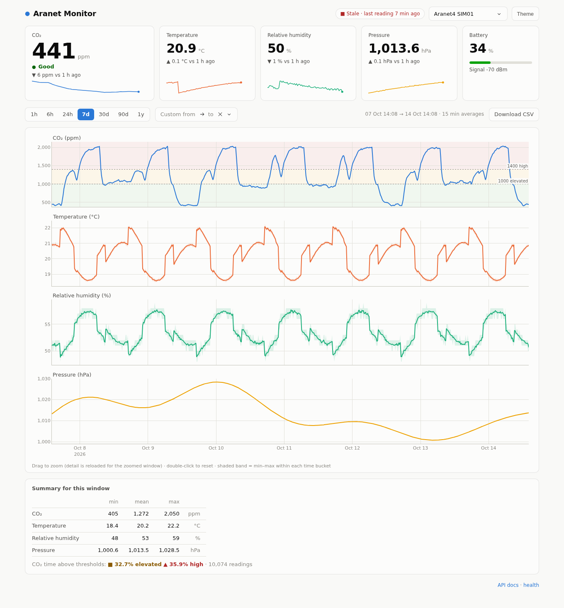

# aranet4-monitor

This project continuously records readings from an **Aranet4** CO₂ monitor (and other Aranet BLE sensors) into SQLite or Postgres, and serves a fast dashboard for them. The stack is:

- **[Aranet4-Python](https://github.com/Anrijs/Aranet4-Python)** for BLE decoding
- **FastAPI** for the REST API
- **Plotly Dash** for the dashboard

## Run it

Run these from the repo directory, with `.env` configured (see [`.env.example`](.env.example)).

**1. Make it permanent.** This survives logout and reboot:

```bash
./scripts/devctl.sh stop all            # stop any dev processes first
./deploy/install-user-services.sh       # install + start aranet-collector and aranet-web
loginctl enable-linger "$USER"          # start at boot and keep running while logged out
```

**2. View the dashboard:** open **http://127.0.0.1:8050/**. It refreshes itself every 30 s.

To view it from other devices on your network, set `ARANET_WEB_HOST=0.0.0.0` and `ARANET_WEB_PASSWORD=<something>` in `.env`, then run `systemctl --user restart aranet-web`.

**3. Check it's recording:**

```bash
systemctl --user status aranet-collector aranet-web    # both: active (running)
journalctl --user -u aranet-collector -f               # live log: one reading per minute
uv run aranet status                                   # newest reading's age + recent events
```

**Day to day:**

```bash
systemctl --user restart aranet-collector aranet-web   # after editing .env or updating code
uv run aranet backfill AA:BB:CC:DD:EE:FF               # manual gap fill (normally automatic)
./deploy/install-user-services.sh uninstall            # remove the services
```

If the collector is down for less than about 3.5 days, the missing readings are downloaded from the sensor automatically when it restarts. This needs a one-time [pairing](docs/DEPLOYMENT.md#3-pair-the-sensor-one-time-needed-for-history-backfill). Readings are never duplicated.



## Features

- **Battery-friendly collection.** With *Smart Home integrations* enabled, the sensor broadcasts each new reading in its BLE advertisements. The collector just listens, without connecting, and stores exactly one row per logged measurement.
- **Gap backfill.** After downtime, the collector downloads the missing points from the sensor's on-device history (5,040 records: about 3.5 days at the 60 s interval) over GATT. This needs a one-time pairing; see the [pairing](docs/DEPLOYMENT.md#3-pair-the-sensor-one-time-needed-for-history-backfill) section of DEPLOYMENT.md. Advert and history timestamps are merged without duplicates.
- **SQLite or Postgres** through one `ARANET_DB_URL`. An hourly rollup table keeps long ranges fast: 1-year views are served in about 50 ms on SQLite and 35 ms on Postgres.
- **Dashboard:**
  - **Tiles:** live KPI tiles with CO₂ status (good/elevated/high), deltas versus 1 h ago, and 6 h sparklines.
  - **Charts:** linked small-multiple charts for CO₂, temperature, RH and pressure, with min–max envelopes. Range presets run from 1 h to 1 y, plus a custom date range. Drag-to-zoom reloads finer data.
  - **Summary:** a summary table with time spent above the CO₂ thresholds, and CSV export.
  - **Display:** light/dark theme and a mobile layout.
- **REST API** with an OpenAPI schema at `/api/openapi.json` (Swagger UI at `/api/docs` with `ARANET_API_DOCS=1`).
- **Simulator** (`aranet simulate` / `aranet seed`) for development without hardware.

## Quick start (from scratch)

```bash
uv sync                                   # Python 3.12 env + deps (SQLite and Postgres)
uv run aranet scan                        # find your sensor; check readings are in the adverts
uv run aranet collect                     # start recording (Ctrl-C to stop)
uv run aranet serve                       # dashboard on http://127.0.0.1:8050/
```

To run the collector and web app permanently as systemd user services:

```bash
./deploy/install-user-services.sh
loginctl enable-linger "$USER"            # optional: keep running while logged out / after boot
```

To try the dashboard without a sensor:

```bash
uv run aranet seed --db sqlite:///data/sim.sqlite --days 90
ARANET_DB_URL=sqlite:///data/sim.sqlite uv run aranet serve
```

## Commands

| Command | Purpose |
|---|---|
| `aranet scan [--seconds N]` | List nearby Aranet devices and their advertised readings |
| `aranet collect` | Continuous listen-only collector with gap backfill |
| `aranet backfill ADDR [--all] [--last N]` | Download on-device history now (requires pairing) |
| `aranet serve [--host H] [--port P]` | API + dashboard (read-only; refuses a non-loopback host without `ARANET_WEB_PASSWORD` unless `--allow-no-auth`) |
| `aranet status` | Data freshness and recent collector events, as JSON |
| `aranet export [--start ISO] [--end ISO]` | Raw readings as CSV on stdout |
| `aranet simulate` / `aranet seed --days N` | Synthetic data (use a separate DB) |
| `aranet copy-db [--source URL] [--target URL]` | Copy all data between databases (idempotent; e.g. SQLite to Postgres) |
| `aranet rollup` | Rebuild the hourly rollup table |
| `aranet grant-read ROLE` | Give a Postgres role read-only access, e.g. for the dashboard |
| `aranet db-init` | Create the tables (`serve`, `status` and `export` never run DDL) |

Configuration is via environment variables or a `.env` file; see [`.env.example`](.env.example).

## API

| Endpoint | Returns |
|---|---|
| `GET /api/v1/health` | Freshness per device and recent collector events |
| `GET /api/v1/devices` | Known sensors |
| `GET /api/v1/devices/{id}/latest` | Newest reading |
| `GET /api/v1/devices/{id}/readings?range=7d&metrics=co2,temperature&max_points=1500` | Downsampled series (mean/min/max per bucket) |
| `GET /api/v1/devices/{id}/stats?range=30d` | Min/mean/max and % of time above CO₂ thresholds |
| `GET /api/v1/devices/{id}/export.csv?start=…&end=…` | Streaming raw CSV |
| `GET /api/v1/events` | Collector event log |

## Documentation

- [docs/ARCHITECTURE.md](docs/ARCHITECTURE.md): design, data model and the dedupe/rollup logic
- [docs/DEPLOYMENT.md](docs/DEPLOYMENT.md): this host, a Raspberry Pi, Postgres, and pairing
- [docs/FINDINGS.md](docs/FINDINGS.md): what we learned about the Aranet4, BLE/BlueZ, the libraries and performance
- [docs/DEVLOG.md](docs/DEVLOG.md): step-by-step development log
- [docs/SECURITY.md](docs/SECURITY.md): checklist before publishing or exposing the app
- [docs/ROADMAP.md](docs/ROADMAP.md): manual steps still needed, next features and known limitations

## Development

```bash
uv run pytest                              # unit/integration tests (SQLite)
ARANET_TEST_PG_URL=postgresql+psycopg://… uv run pytest   # fixture-based DB tests on Postgres
uv run --group e2e pytest -m e2e           # headless-Chrome dashboard tests (uses installed Chrome)
uv run ruff check . && uv run ruff format .
./scripts/devctl.sh {start|stop|status} [collector|web|web-sim]   # dev processes w/o systemd
```

## License

MIT. The project builds on [Aranet4-Python](https://github.com/Anrijs/Aranet4-Python) (MIT). The dashboard is inspired by [EnviroPlusWeb](https://github.com/nophead/EnviroPlusWeb).
