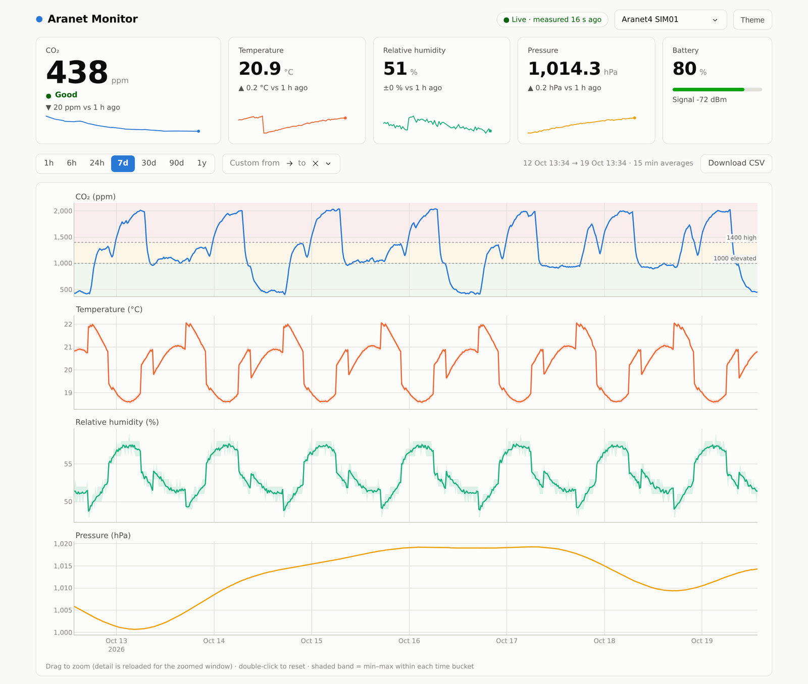
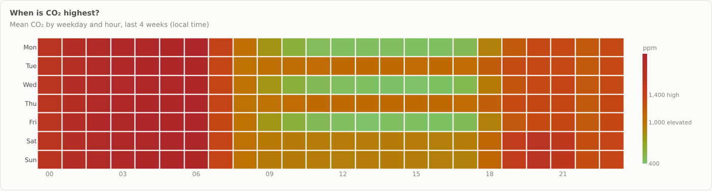
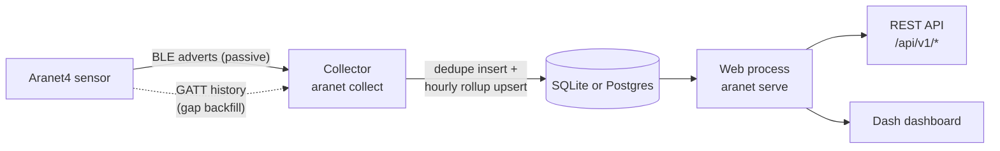

# Home Sensors: Aranet4 CO₂ monitor

[](https://github.com/ronaldBuddys/home-sensors/actions/workflows/ci.yml)

[](LICENSE)
[](https://github.com/astral-sh/ruff)

Records an [Aranet4](https://aranet.com/) CO₂ sensor over Bluetooth into **SQLite or Postgres**, serves the readings through a **REST API**, and shows them on a fast **dashboard**. It runs unattended on a Raspberry Pi next to the sensor. No sensor? The demo below runs the whole stack on simulated data.

<picture>
  <source media="(prefers-color-scheme: dark)" srcset="docs/img/dashboard-dark.png">
  
</picture>

## Try it in 60 seconds (no sensor needed)

You need [uv](https://docs.astral.sh/uv/getting-started/installation/). It downloads a suitable Python by itself.

```bash
git clone https://github.com/ronaldBuddys/home-sensors.git
cd home-sensors
uv sync
uv run aranet demo
```

Then open **http://127.0.0.1:8050**. The demo:

- seeds 30 days of realistic simulated readings, including overnight bedroom CO₂ ramps, weekday/weekend routines and passing weather;
- writes a new reading every minute;
- serves the dashboard and the API from one process.

It keeps its data in its own `data/demo.sqlite` and never touches a configured database. Press Ctrl-C to stop it.

<details>
<summary>Without uv</summary>

```bash
python3.11 -m venv .venv && . .venv/bin/activate   # any Python 3.11+
pip install -e .
aranet demo
```

</details>

## What it does

### Talks to devices and serves an API

- **Listens to the sensor without connecting.** With *Smart Home integrations* on, the Aranet4 broadcasts each reading in its Bluetooth LE adverts. The collector ([`ble/collector.py`](src/aranet_monitor/ble/collector.py), asyncio + [bleak](https://github.com/hbldh/bleak)) just listens, so collecting costs the sensor no battery. It stores exactly one row per logged measurement and drops implausible values.
- **Fills gaps from the sensor's memory.** After downtime it downloads the missing points from the device's on-board history (5,040 records, about 3.5 days) over GATT. The download is chunked, retried and resumable, so it survives a flaky radio link and the ring buffer shifting mid-download ([`ble/history.py`](src/aranet_monitor/ble/history.py)).
- **Serves a read-only REST API** with FastAPI, with an OpenAPI schema at `/api/openapi.json`:

  ```console
  $ curl -s localhost:8050/api/v1/devices/1/latest
  {"device_id": 1, "ts": 1792413255, "age_s": 40, "source": "sim", "co2": 438,
   "temperature": 20.85, "humidity": 51.0, "pressure": 1014.3, "battery": 80, ...}

  $ curl -s "localhost:8050/api/v1/devices/1/readings?range=7d&metrics=co2&max_points=10"
  {"device_id": 1, "start": 1791808499, "end": 1792413299, "bucket_s": 86400, "count": 8,
   "t": [1791806400, 1791892800, ...],
   "mean": {"co2": [924.4, 1350.89, ...]}, "min": {"co2": [408.0, ...]}, "max": {"co2": [1730.0, ...]},
   "units": {"co2": "ppm"}}
  ```

  | Endpoint | Returns |
  |---|---|
  | `GET /api/v1/health` | Data freshness per device and recent collector events |
  | `GET /api/v1/devices` · `/devices/{id}` | Known sensors |
  | `GET /api/v1/devices/{id}/latest` | Newest reading |
  | `GET /api/v1/devices/{id}/readings?range=7d&metrics=co2,temperature` | Series downsampled to `max_points` (mean/min/max per bucket) |
  | `GET /api/v1/devices/{id}/stats?range=30d` | Min/mean/max, and the share of time above the CO₂ thresholds |
  | `GET /api/v1/devices/{id}/co2-heatmap?days=28` | Mean CO₂ by weekday × local hour |
  | `GET /api/v1/devices/{id}/export.csv?start=…&end=…` | Raw readings, streamed as CSV |
  | `GET /api/v1/events` | Collector event log |

### Puts SQL to work

The same SQLAlchemy Core code runs on **SQLite and Postgres**, and CI tests both.

- **Time-series storage.** `readings` has a composite primary key `(device_id, ts)` (`WITHOUT ROWID` on SQLite, so rows are clustered by time) ([`db/schema.py`](src/aranet_monitor/db/schema.py)).
- **An hourly rollup kept by upsert.** `INSERT … SELECT … ON CONFLICT DO UPDATE` keeps sum, count, min and max per device-hour. Conditional aggregation (`SUM(CASE …)`) counts time above fixed CO₂ levels ([`db/rollup.py`](src/aranet_monitor/db/rollup.py)). A year of data then charts in about 50 ms.
- **Exact re-aggregation.** Long windows read the rollup and recombine it as `SUM(sum) / NULLIF(SUM(cnt), 0)` with integer bucketing, so the means are exact, not averages of averages ([`db/queries.py`](src/aranet_monitor/db/queries.py)).
- **The weekday × hour heatmap, timezone-correct.** The window is split at each DST change, and each piece runs one grouped `SELECT` keyed on `((hour + :utc_offset) / 3600) % 168`, with the offset as a bound parameter ([`Queries.co2_heatmap`](src/aranet_monitor/db/queries.py)).
- **Gap detection with a window function.** `LEAD(ts) OVER (ORDER BY ts)` finds holes in the stored data to backfill ([`db/store.py`](src/aranet_monitor/db/store.py)).
- **Keyset pagination** for streaming CSV exports, and **insert-or-ignore** for an idempotent SQLite→Postgres copy (`aranet copy-db`).
- **Least privilege on Postgres:**
  - the app's own schema;
  - a dashboard role granted `SELECT` only (`aranet grant-read`, using `ALTER DEFAULT PRIVILEGES`);
  - read-only transactions for the web app;
  - TLS with `verify-full`.
- **Migrations with [Alembic](https://alembic.sqlalchemy.org/).** A baseline revision matches the schema exactly (CI checks this on both engines). Existing databases are stamped automatically (`aranet db-upgrade`).

### Visualises the results

- **Live tiles** with CO₂ status, change against an hour ago, and sparklines.
- **Linked small-multiple charts** for CO₂, temperature, humidity and pressure:
  - min–max envelopes;
  - CO₂ threshold bands;
  - range presets from 1 h to 1 y, plus custom dates;
  - drag-to-zoom reloads finer data.
- **The answer to "when do I need to ventilate?"** A weekday × hour heatmap of mean CO₂, coloured by the CO₂ thresholds (green, amber at "elevated", red at "high"):

  <picture>
    <source media="(prefers-color-scheme: dark)" srcset="docs/img/heatmap-dark.png">
    
  </picture>

- **Light and dark themes** and a **mobile layout**. The palette was checked for colour-vision deficiency, and status colours always come with a label.

## How it fits together



The two processes share nothing but the database, so the collector can run on a Pi next to the sensor while the dashboard runs anywhere else. Details are in [docs/ARCHITECTURE.md](docs/ARCHITECTURE.md).

## Run it with a real sensor

The short version for a Raspberry Pi (3, 4, 5 or Zero 2 W, 64-bit OS) or any Linux machine with Bluetooth:

1. In the Aranet Home app, turn on **Settings → Smart Home integrations**.
2. Clone the repo, run `uv sync --frozen --no-dev`, then `uv run --no-dev aranet scan`. Your sensor and its readings should be listed.
3. Copy `.env.example` to `.env` and set `ARANET_DEVICES` to the sensor's address.
4. Optional: pair once with `bluetoothctl` (PIN on the sensor's display) so gaps can be backfilled.
5. Run `./deploy/install-user-services.sh` and `loginctl enable-linger "$USER"`. These install the collector and the dashboard as sandboxed systemd user services.

[docs/DEPLOYMENT.md](docs/DEPLOYMENT.md) covers everything else: pairing, Postgres with TLS and a read-only role, HTTPS for the dashboard on your LAN, and upgrading.

## Commands

| Command | Purpose |
|---|---|
| `aranet demo` | Simulated sensor and dashboard in one process (own SQLite file) |
| `aranet scan` | List nearby Aranet devices and their advertised readings |
| `aranet collect` | Continuous listen-only collector with gap backfill |
| `aranet serve` | API and dashboard (read-only; refuses a LAN bind without a password) |
| `aranet backfill ADDR [--all]` | Download on-device history now (needs pairing) |
| `aranet status` | Data freshness and recent collector events, as JSON |
| `aranet export [--start ISO] [--end ISO]` | Raw readings as CSV |
| `aranet db-upgrade` | Create or migrate the schema (`db-init` is an alias) |
| `aranet copy-db --source URL` | Copy all data between databases, e.g. SQLite → Postgres (idempotent) |
| `aranet grant-read ROLE` | Give a Postgres role read-only access, e.g. for the dashboard |
| `aranet rollup` | Rebuild the hourly rollup table |
| `aranet seed` / `aranet simulate` | Synthetic history / live synthetic readings |

Configuration is through environment variables or a `.env` file; see [`.env.example`](.env.example).

## Development

```bash
uv sync --group e2e
uv run ruff check . && uv run ruff format --check .
uv run pytest                                   # unit and integration tests (SQLite)
docker run -d --rm --name pg -e POSTGRES_PASSWORD=pg -p 55432:5432 postgres:17
ARANET_TEST_PG_URL=postgresql+psycopg://postgres:pg@localhost:55432/postgres uv run pytest
uv run pytest -m e2e tests/e2e                  # headless-Chrome dashboard tests
```

CI runs lint, the tests on Python 3.11–3.13, the full suite on Postgres 17 and the browser tests on every pull request and on pushes to `main`. A weekly job runs `pip-audit` on the lock file. See [CONTRIBUTING.md](CONTRIBUTING.md) for conventions.

```
src/aranet_monitor/
├── ble/        advert parsing, passive collector, GATT history download
├── db/         schema, store (writes), queries (reads), rollup, Alembic migrations
├── api/        FastAPI app, routes, Basic-auth middleware, security headers
├── web/        Dash app, Plotly figure builders, CSS and client-side JS
├── sim/        deterministic simulated Aranet4
└── cli.py      the `aranet` command
```

## Documentation

- [ARCHITECTURE.md](docs/ARCHITECTURE.md): design, data model, dedupe, rollup and backfill logic.
- [DEPLOYMENT.md](docs/DEPLOYMENT.md): Raspberry Pi, pairing, services, Postgres, HTTPS, upgrading.
- [FINDINGS.md](docs/FINDINGS.md): engineering notes on the Aranet4 protocol, BlueZ, the libraries and performance.
- [SECURITY.md](docs/SECURITY.md): security model and accepted risks. To report a vulnerability, see the [security policy](SECURITY.md).
- [ROADMAP.md](docs/ROADMAP.md): known limitations and what's next. Ideas are tracked as [issues](https://github.com/ronaldBuddys/home-sensors/issues).

## License

[MIT](LICENSE). Built on [Aranet4-Python](https://github.com/Anrijs/Aranet4-Python) (MIT). The dashboard was inspired by [EnviroPlusWeb](https://github.com/nophead/EnviroPlusWeb).
