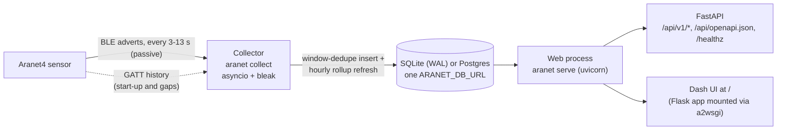

# Architecture

Dash callbacks call the query layer in-process, not over HTTP.

There are two processes, and they share nothing but the database. The collector can therefore run on a Raspberry Pi next to the sensor while the web app runs elsewhere against the same Postgres.

## Code layout

| Module | Responsibility |
|---|---|
| `config.py` | Frozen `Settings.from_env()` (env vars plus `.env`) |
| `models.py` | `Reading` / `DeviceInfo` dataclasses; metric names and units |
| `ble/parse.py` | Advert bytes to `Reading`. Wraps `aranet4.Aranet4Advertisement`; adds the measurement timestamp and drops physically implausible values |
| `ble/collector.py` | Passive scanner, consumer queue, new-measurement detection, backfill scheduling, watchdog |
| `ble/history.py` | GATT history download with per-step timeouts |
| `db/schema.py` | Tables: `devices`, `readings`, `readings_hourly`, `collector_events` |
| `db/store.py` | Engine factory (SQLite pragmas, Postgres schema and read-only mode), migration-based `init_db`, device upsert, dedupe insert, events |
| `db/migrations/` | Alembic environment and revisions (baseline `0001` = the schema above) |
| `db/rollup.py` | Hourly rollup maintenance (incremental upsert and full rebuild) |
| `db/queries.py` | Read side: latest, bucketed series, stats, weekday × hour heatmap, export, health |
| `api/` | FastAPI app factory, routes, optional Basic-auth middleware |
| `web/` | Dash app (`dash_app.py`), figure builders (`figures.py`), CSS and client-side JS |
| `sim/` | Deterministic synthetic Aranet4 |
| `cli.py` | `aranet` command |

## Data model

### `readings`

There is one row per **logged measurement**, with primary key `(device_id, ts)`. On SQLite the table is `WITHOUT ROWID`, so rows are clustered by time.

- `ts` is the integer epoch seconds (UTC) at which the **device** logged the value. It is computed as `receive_time − ago`, not taken from the time the advert was received.
- `source` is one of `adv`, `history` or `sim`.
- `battery`, `status` and `rssi` exist only for advert rows; history rows leave them NULL.
- Columns for Radon and Radiation models exist but are only populated for those devices.

### `readings_hourly`

For each metric, this table stores `sum`, `cnt`, `min` and `max` per device-hour, plus `co2_ge_{800,1000,1200,1400,1500,2000}` counts. Means re-aggregate *exactly* into any bucket that is a whole number of hours.

### Other tables

- `devices`: address, name, model, firmware, interval, first/last seen and last RSSI.
- `collector_events`: start/stop, `device_seen`, `backfill`, `backfill_error`, `scanner_restart`, the clock-sync wait (`clock_wait`/`clock_synced`/`clock_unsynced`) and warnings. It is shown in the dashboard footer and in `/api/v1/health`.
- `alembic_version`: the schema revision. On Postgres it lives in the app's schema.

### Schema changes

Writers (`collect`, `backfill`, `db-upgrade`, `rollup`, `seed`/`simulate`/`demo` and the `copy-db` target) run `init_db`, which applies Alembic migrations up to the newest revision. It handles three cases:

- **Empty database:** migrated from scratch.
- **Created before migrations existed** (tables but no `alembic_version`): checked, then stamped at the baseline with no data change.
- **Versioned database:** brought up to head.

Read-only paths (`serve`, `status`, `export`) only check that the tables exist, so the dashboard's database role never needs DDL. `tests/test_migrations.py` fails if `upgrade head` and `metadata` differ, on SQLite and on Postgres.

## Collector logic

**Start-up.** Two waits come before anything else.

- **The database.** The collector opens it with in-process retries: connection errors back off from 2 s to 60 s, with one log line each. Other errors fail at once.
- **The clock.** With `ARANET_WAIT_CLOCK_SYNC_S` set, it waits (bounded) until the system clock is NTP-synchronised. A Pi has no RTC, and readings are stamped with the host clock. It checks the systemd-timesyncd marker, or falls back to `timedatectl`.

The BLE scanner only starts after both. Then:

1. **Callback.** The `BleakScanner` detection callback filters on manufacturer id `0x0702` and the optional allow-list, then enqueues the raw bytes. It never touches the DB, so the BLE event loop stays responsive.
2. **New-measurement test.** The consumer parses each advert. A reading is new when its measurement time is more than interval/2 after the newest stored row. Re-adverts of the same measurement (about 5–6 per minute, ±1 s jitter) fail that test and are dropped. The counter byte is decoded but **not** relied on: a firmware that didn't increment it must not cause silent data loss.
3. **Window dedupe.** `Store.insert_readings` skips any row within ±(interval/2 − 1) s of an existing row. This merges advert-derived and history-derived points, which both carry about ±1 s of host-clock jitter. It then refreshes the touched hourly rollup buckets in the same transaction.
4. **Gap detection.** A new reading more than `max(ARANET_GAP_BACKFILL_MIN_S (150 s), 1.5 × interval)` after the newest stored row marks a gap. The cause doesn't matter: the collector was down, the scanner paused for a backfill, a radio dropout, or start-up. The gap's start (`backfill_since`) stays **pending until a backfill succeeds**.
5. **Backfill.**
   - **Throttling.** At most one GATT session per 15 min per device, to protect the battery. The device keeps 5,040 records (about 3.5 days at 60 s), so deferring loses nothing.
   - **Procedure.** The scanner is stopped, because BlueZ connect-while-scanning is flaky. `ble/history.py` downloads records after `backfill_since` with per-step timeouts. It re-reads `total`/`ago` afterwards, and retries if the device logged a point mid-download, since that would offset the columns. Rows are inserted and the scanner restarts, except during shutdown.
   - **Failures** (typically: not paired) back off exponentially: 15 min, 30 min, … up to 6 h. The gap stays pending.
6. **Watchdog.** If no adverts arrive for `ARANET_WATCHDOG_S` (180 s), the scanner is restarted. Scanner start and stop have 20 s timeouts, so a hung BlueZ call can't wedge the lock. The watchdog also tracks adverts from *any* device. If other devices are still heard, the sensor is just out of range. If nothing at all is heard, even after a scanner restart, the controller has gone deaf (seen on the Pi's onboard chip while BlueZ still reports `Discovering: yes`), and the adapter is power-cycled over D-Bus, which needs no root. This is Linux only. It can be turned off with `ARANET_ADAPTER_RESET=0`, e.g. when the adapter is shared with headphones, which would be dropped by a power-cycle.

   **Adapter selection.** `ARANET_BLE_ADAPTER` (e.g. `hci1` for a USB dongle) picks the BlueZ adapter used for scanning, backfills, the power-cycle and the `aranet scan`/`aranet backfill` commands. Unset means bleak's default adapter, and the power-cycle then targets the first adapter BlueZ lists, so set it explicitly on machines with more than one adapter. On macOS and Windows the OS chooses the adapter, and the setting is ignored.
7. **Shutdown.** SIGINT/SIGTERM cancels any running backfill, stops the scanner and writes a `stop` event with counters.

## Read path and performance

`Queries.series` picks a bucket so that a window yields at most `max_points` points. Buckets snap to round sizes: 1, 2, 5, 10, 15 and 30 min, and 1, 2, 3, 6 and 12 h, 1 d, 2 d and 7 d.

- **Bucket 0:** raw rows.
- **Bucket under 1 h:** `GROUP BY ts // bucket` over `readings`, a PK range scan.
- **Bucket of 1 h or more:** re-aggregated from `readings_hourly`, which reads about 8.8 k rows per year instead of 525 k.

Buckets are plotted at their centre. A gap longer than 2.5 buckets inserts a `None` so the line breaks. `stats` uses the rollup for windows longer than 7 days, as long as the thresholds are among the pre-computed CO₂ levels.

The dashboard requests at most 1500 points for windows up to 24 h, which keeps 1-min data raw, and 700 points beyond that. At 700 points the 1 y view gets **daily** buckets. Sub-daily buckets alias the strong day/night CO₂ cycle into a solid band.

## Web layer

- **Process model.** FastAPI owns the ASGI app. `GZipMiddleware` compresses both API and Dash responses, and Dash's own compression is disabled. The Dash Flask server is mounted at `/` through `a2wsgi.WSGIMiddleware`; routes registered before the mount take precedence.
- **Refresh.** `dcc.Interval` polls `latest_ts` every `ARANET_REFRESH_S` (30 s). The tiles and chart only re-render when it changes. Zoomed or custom windows hold their frame instead of refreshing.
- **Client-side work.** The relative "measured N s ago" pill and the theme toggle run as client-side callbacks, with no server round-trip.
- **Zoom and the chart window.** One server callback, `choose_window`, owns the chart window: presets, custom dates, device changes and zoom/reset all go through it.
  - **Why a single owner:** dash-renderer keeps only the newest request when a callback is re-triggered while in flight, so a single owner means the user's last action wins.
  - **Filtering in the browser:** Plotly also emits `relayoutData` for its own reasons (autosize after the first draw, a dragmode change). Those must never reach the server, or they cancel a preset click that is still in flight. A client-side function (`assets/app.js`, `aranet.zoomRequest`) passes only real x-range zooms and autorange resets into a `zoom-req` store; `choose_window` listens to that store.
  - **Zooming and resetting:** a zoom becomes a new window and a re-query at finer resolution. Double-click returns to the preset, and a stable `uirevision` keeps the zoom across refreshes.
- **Local time on the x-axis.** Plotly has no time-zone-aware axis, so timestamps are drawn as naive local times. On the DST fall-back night local time repeats an hour; the figure inserts a break wherever x goes backwards, so the repeated hour is drawn as its own segment. The min–max envelope is one closed polygon per contiguous segment, so it never bridges a gap.
- **Weekly pattern.** The "When is CO₂ highest?" heatmap comes from `Queries.co2_heatmap`. The window is split into pieces of constant UTC offset, one per DST change. Each piece runs one grouped `SELECT` over `readings_hourly`, keyed on `((hour + :utc_offset) / 3600) % 168`, the hour of the week. The sums and counts are merged per cell, so the means are exact. The figure colours cells green → amber → red, with the transitions at `ARANET_CO2_WARN` and `ARANET_CO2_ALERT` (labelled on the colour bar), so it agrees with the status tiles and chart bands.
